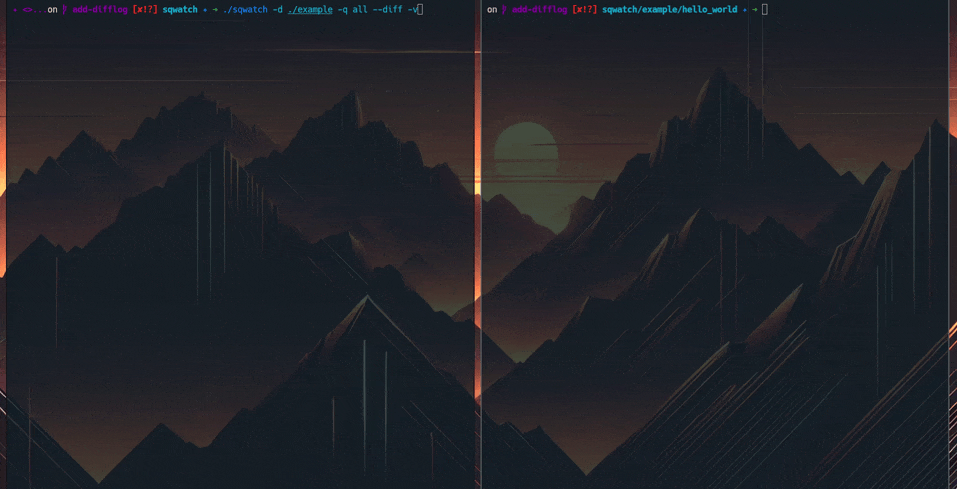

# SQWatch

*A Lightweight File System Monitor and Task Automation Tool*

Monitor files and directories for changes, execute commands automatically, and track modifications with built-in diff and logging capabilities. Designed for reliable file watching with minimal overhead.

## Overview

SQWatch monitors specified files or directories for quality changes (such as modifications, creation, or deletion) and triggers custom commands when these changes are detected. It's designed to be simple, efficient, and easy to integrate into development workflows.



## Features

- File and directory monitoring
- Custom command execution
- Low resource footprint
- Simple integration with build tools
- Diff tracking (binary and text) for file changes
- Change logging with timestamps
- Atomic save detection (works with modern editors, such as helix)
- Recursive directory watching
- Automatic watch recovery
- Debounce support for rapid changes

## Dependencies

SQWatch requires:
- Linux kernel with inotify support
- GCC or compatible C compiler
- GNU Make

For Nix users, all dependencies are handled automatically through the nix-shell environment.

## Installation

If using Nix:

```bash
git clone https://github.com/cloudripper/sqwatch.git
cd sqwatch
nix-shell
```

If using make:

```bash
# Clone the repository
git clone https://github.com/cloudripper/sqwatch.git
cd sqwatch

# Build the project
make

# Install the binary to your path
sudo install -D ./sqwatch /usr/local/bin/sqwatch
```

## Usage

Basic syntax:
```bash
sqwatch -d DIR | -f FILE [options]
```

How files are watched: sqwatch watches directories, one inotify watch each, and sees what happens to the files in them through those watches, by name. A `-f FILE` is watched through the watch of its directory, limited to that name, so it is still followed when it is deleted and made again, or replaced by an editor. Each name of a file with hard links is a file of its own; a change made through a name outside the watched trees is not seen. A file moved out of the tree and back in within a few seconds, under any name, keeps what sqwatch knew of it: a change made before it left is still diffed, against what it held before. When a watch cannot be set (for example, the inotify watch limit `fs.inotify.max_user_watches` is reached), sqwatch says so once, loudly, and runs the command as after lost events (`SQWATCH_EVENT=overflow`): what is beneath that directory is not seen.

Watch:
- `-d DIR`: Directory to watch, with everything beneath it (repeatable)
- `-f FILE`: File to watch (repeatable), through its directory: it is followed when it is deleted and made again
- `-q EVENTS`: Events to react to, separated by commas, for example `-q modify,create` (default: `modify`)
  - `modify`: a file was written
  - `create`: a file or directory was created
  - `delete`: a file or directory was deleted
  - `move`: a file or directory was moved or renamed
  - `attrib`: mode, owner or times changed
  - `open`: a file was opened
  - `access`: a file was read
  - `all`: all of the above but `open` and `access`

  sqwatch's own reads of the watched files (the copies and diffs of `--diff`, its checks, and the walk after lost events) never count as `open` or `access`: while sqwatch reads a file, the watch of its directory leaves out read events, so the kernel queues none for that read. A process that reads a file of the same directory in that moment is not seen either. The command's reads do count: a command that reads a file watched with `-q open` starts itself again, debounce after debounce. Keep what the command reads out of the watched trees, or out of the watch with `-i`
- `-i PATTERN`: Ignore what matches PATTERN (repeatable). An ignored directory is not watched and not walked; an ignored file never triggers the command, is never diffed and never cached. PATTERN is a shell pattern (see `fnmatch(3)`). A PATTERN with a `/` is matched against the path below the watched directory (`/` is only matched by `/`), any other against the name alone; a trailing `/` is dropped. For example `-i '*.o' -i build/tmp`. Always ignored: `.git`, and sqwatch's own log file and cache directory when they are inside a watched tree. Ignores apply at startup, to entries created or moved in later, and when the tree is walked again after lost events

Command:
- `-c COMMAND`: Run COMMAND with `/bin/sh -c` on each change; a run still going is stopped and started again. Without `-c`, sqwatch runs in observe mode: it shows every event (and diff, with `--diff`) and runs nothing, with no debounce unless `-t` is given; `-w` and `-s` then only draw a warning
- `-w`: Wait for a run still going to end instead of stopping it. The changes that come while it runs lead to exactly one more run, started once it has exited (its first process, the shell). Without `-w` a run still going is stopped and the command started again
- `-s SIGNAL`: Signal that stops a run, on a restart and when sqwatch exits: a name, with or without `SIG`, in any case (`TERM`, `sigint`, `RTMIN+2`), or a number (default: `TERM`). What is left of the run's process group gets `KILL` 2 s later on a restart, 5 s later (or at a second signal to sqwatch) on exit. `STOP`, `TSTP`, `TTIN` and `TTOU` are refused, as they would pause the command instead of stopping it, and so is `CONT`, which stops nothing
- The command gets the change that started it in its environment, never in the command string:
  - `SQWATCH_PATH`: the path of the file or directory, as sqwatch shows it (relative to the `-d` or `-f` path given), byte for byte
  - `SQWATCH_EVENT`: `modify`, `create`, `delete`, `move`, `attrib`, `open` or `access`; `overflow`, with an empty `SQWATCH_PATH`, when events were lost and the tree was walked again, or when a directory could not be watched. After lost events sqwatch says so with a trigger line, walks the tree again (at most once a second, and once more after the last loss), reports each file it no longer finds as deleted and each new one as created, diffs each file that changed, and runs the command once, with `overflow`

  Quote them: `sqwatch -d src -c 'echo "changed: $SQWATCH_PATH ($SQWATCH_EVENT)"'`. When changes come together (in one batch of events, or inside the debounce window of the last run), they lead to one run, and that run gets the latest of them.
- `-t SECONDS`: Debounce time of each file, a decimal number of seconds such as `2` or `0.25`, from 0 to 86400 (default: 1, or 0 in observe mode)

  A write is handled once the writer closes the file, so an editor that saves in chunks (helix writes 8 KB at a time) or saves to a new file (vim, helix) gives one run, on the whole file. A writer that keeps the file open is handled after 0.1 s without a write, and at least once per debounce time while it keeps writing.

sqwatch writes its output a line at a time, whether to a terminal, a pipe or a file, and flushes it before it starts the command, so that its lines and the command's stay in order and none is written twice.

When sqwatch runs in the foreground of a terminal, each run of the command gets that terminal, as a shell's foreground job does: interactive commands such as `docker run -it` or an editor read input and print instead of being stopped. While a run holds it, ^C goes to the run; a run ended by ^C ends sqwatch too. Once the run exits or is stopped, sqwatch takes the terminal back with the modes it found.

Intercept (fanotify; needs the `CAP_SYS_ADMIN` capability, that is, root):
- `-p EVENTS`: Hold each `open`, `access` (read) or `exec` of the watched files, separated by commas (repeatable; the lists add up), until the command (`-c`, required) decides: exit status 0 allows it, any other status denies it, and the opener gets `EPERM`. This is a gate, and it fails closed: an access the command does not allow in time, or that cannot be put to it, is denied (see `-T`).
  - The command decides on the file being opened, which it gets as its descriptor 3 (`SQWATCH_FD=3`). A check must read `/dev/fd/3` (or `fstat` it), never the path: the name can point to another file by the time the command looks. `SQWATCH_PATH` is for information only (the watched name of the file, or else where its descriptor leads), and may hold any byte, newlines included. The command also gets `SQWATCH_EVENT` (`open`, `access` or `exec`) and `SQWATCH_PID`, the process that opens the file. Decide on who that process runs as, not on what it calls itself: its name (`/proc/PID/comm`) and command line are whatever it wants them to be. For example, to keep a key away from everyone but root:
    ```bash
    sudo sqwatch -f secret.key -p open -c 'test "$(stat -c %u /proc/$SQWATCH_PID)" = 0'
    ```
  - Denied without asking: an access that waited longer than the timeout (counted from its arrival, whatever else is waiting); one beyond the 256 that can wait, or beyond 64 waiting from the same user; one to a file sqwatch cannot name; one the command could not be started for; and every access still waiting when sqwatch exits (SIGINT, SIGTERM, SIGHUP). If sqwatch is killed outright (SIGKILL, a crash, the OOM killer), the kernel removes its marks and lets everything through: run it where that cannot happen unnoticed.
  - One command runs at a time, in a session of its own. sqwatch's own reads (with `--diff`) and the processes of the command's session are always allowed, so neither can wait on itself.
  - The watched directories are marked (a directory's mark covers the files in it), and each watched file on its own, so that a file moved out of the watched trees stays gated until sqwatch exits; never a mount or a filesystem. The marks follow new and moved-in files and directories as the watches do, once sqwatch has seen them come: a directory made, or moved in, is gated from then on, normally within milliseconds, not before. With `-p`, `-i` and `.git` exempt nothing from the gate: ignored directories are marked too, and only left out of what is reported. A directory that cannot be marked at startup ends sqwatch (exit status 1); later, sqwatch says so loudly, and denies what it cannot name beneath it.
  - What the kernel does not hold: `-p access` sees `read()` and the like, not reads of a file mapped into memory (`mmap`), and not descriptors opened before sqwatch started. `-p exec` sees `execve()` of the file only, not a binary loaded by the dynamic loader (`ld.so FILE`) nor a script given to its interpreter (`sh FILE`): use `-p open,exec` to gate those as opens.
  - `-p` does not go with `-q`: the command decides and runs for nothing else. `--diff` still shows what is written to the watched files, without running the command. `-w` has no effect.
- `-T TIMEOUT`: Time the command has to decide, from the moment the access is held: a decimal number of seconds above 0 (default: 5), then the command's session is killed and the access denied. `deny` and `SECONDS:deny` say the same. `allow` or `SECONDS:allow` opts into the old, failing open behaviour: whatever is not decided in time, or cannot be put to the command (see above), is allowed

Diff:
- `--diff`: Show what changed in each file, from a private cache. A file over 64 MiB is not copied, nor one that would take all the copies together over 256 MiB: only its size and modification time are kept, and a change to it is reported without a diff (a notice says when that starts). Each diff shown, and logged, stops after 500 lines or 1 MiB, with a note of how many lines were left out
- `-l FILE`: Also write the diffs to FILE (needs `--diff`). FILE may be rotated: once it is renamed away, the next diff goes to a new file under its name. Inside a watched tree, that name is never watched, nor the file it names

Other:
- `-v`: Verbose output
- `-h`, `--help`: Display the help message

Every option is checked when sqwatch starts. A value that cannot be used ends it with exit status 1, a message that names the option and the value, and the values that option takes:

```
$ sqwatch -d src -q modfy
sqwatch: -q 'modfy': 'modfy' is not an event
-q EVENTS: one or more of modify, create, delete, move, attrib, open,
  access, all, separated by commas, for example -q modify,create
```

Examples:
```bash
# Watch a file for modifications and run a command
sqwatch -f main.c -q modify -c "gcc main.c -o program && ./program"

# Watch a directory recursively with diff tracking and logging
sqwatch -d src/ -q all --diff -l changes.log -v

# Watch directory with custom debounce time
sqwatch -d src/ -q modify -t 0.5 -c "make test"
```

## Environment Variables

- `SQWATCH_CACHE_DIR`: Custom location for diff cache files
- `XDG_CACHE_HOME`: Alternative cache directory base (defaults to ~/.cache)

## Contributing

Contributions are always welcome. Feel free to submit issues and pull requests.

